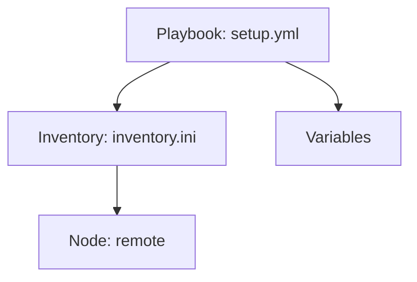

# AGENTS.md

This file provides guidance for AI agents working with this ansible playbook collections repository. It follows the same format as `docker-compose.yml`, `.env.example`, and `README.md` files in each project directory.

## Project Structure

The repository contains ansible playbooks for infrastructure automation and configuration management. Each folder contains a playbook you can run quickly and customize for your environment.

- `setup.yml` - Main installation playbook
- `removal.yml` - Removal playbook
- `inventory.ini` - Target host configuration
- `inventory.ini.example` - Example inventory file
- `docker-vars.yml.example` - Variable examples
- `README.md` - Documentation

## Adding a New Item

When creating a new playbook, follow these steps:

1. Create a new directory for the project
2. Add `setup.yml` with playbook configuration
3. Add `removal.yml` with removal tasks
4. Add `inventory.ini.example` with variable examples
5. Add `docker-vars.yml.example` with required variable defaults
6. Add `README.md` with documentation following the template below

## setup.yml Format

```yaml
---
# setup.yml - Install and configure [SERVICE] with [REGISTRY/other]
#
# Supported: Debian/Ubuntu, RedHat family (Fedora, RHEL, CentOS, Rocky, Alma),
#            SUSE, Arch
#
# Requirements: ansible-galaxy collection install ansible.posix community.general community.docker
#                pip install passlib   (required for registry authentication)
#
# Usage:
#   ansible-playbook -i inventory setup.yml
#   ansible-playbook -i inventory setup.yml -e docker_registry_enabled=false
#   ansible-playbook -i inventory setup.yml -e 'docker_users=[alice,bob]'
```

## .env.example Format

```yaml
# [SERVICE] daemon settings
[SERVICE]_storage_driver: overlay2
[SERVICE]_log_driver: json-file
[SERVICE]_log_max_size: 10m
[SERVICE]_log_max_file: "3"
[SERVICE]_registry_mirrors: []
[SERVICE]_insecure_registries:
  - 127.0.0.1:5000

# Add these users to the [SERVICE] group
[SERVICE]_users: []

# [SERVICE] Compose
[SERVICE]_install_compose: true

# [SERVICE] registry
[SERVICE]_registry_enabled: true
[SERVICE]_registry_image: registry:2
[SERVICE]_registry_port: 5000
[SERVICE]_registry_data_dir: /var/lib/registry

# Registry authentication (htpasswd / bcrypt)
[SERVICE]_registry_auth: true
[SERVICE]_registry_auth_realm: Registry Realm
[SERVICE]_registry_htpasswd_dir: /etc/[service]-registry
[SERVICE]_registry_htpasswd_path: /etc/[service]-registry/htpasswd
[SERVICE]_registry_users:
  - username: admin
    password: "ChangeMe123!"
```

## README.md Template

```markdown
# <Playbook Name>

<Description>

## How it works



1. Playbook adds official [SERVICE] repository (if [SERVICE] playbook)
2. Installs [SERVICE] from repository
3. Configures [SERVICE] with authentication
4. Sets up firewall rules for [SERVICE] port

## Stack details in this repo

- Playbook: `setup.yml` / `removal.yml`
- Target host: `remote` (from inventory.ini)
- [SERVICE] version: Installed from official repository
- [SERVICE] registry: Local registry on port 5000 with htpasswd authentication (if applicable)
- Variables: Defined in `docker-vars.yml.example`

## Environment variables

Set via `docker-vars.yml.example` (copy from `.env.example`):

- `[SERVICE]_storage_driver` (default: `overlay2`)
- `[SERVICE]_log_driver` (default: `json-file`)
- `[SERVICE]_registry_enabled` (default: `true`)
- `[SERVICE]_users` (default: `[]`)
- `[SERVICE]_install_compose` (default: `true`)

## How to run

From the repository root:

```bash
cd ansible-playbook-collections/[PLAYBOOK-NAME]
cp [PLAYBOOK]-vars.yml.example [PLAYBOOK]-vars.yml
# Edit [PLAYBOOK]-vars.yml with your settings
wsl ansible-playbook -i ./inventory.ini setup.yml
```

Remove:

```bash
ansible-playbook -i ./inventory.ini removal.yml
ansible-playbook -i ./inventory.ini removal.yml -e [SERVICE]_remove_registry_data=true # also delete images!
ansible-playbook -i ./inventory.ini removal.yml -e [SERVICE]_remove_registry_auth=false # keep htpasswd
ansible-playbook -i ./inventory.ini removal.yml -e [SERVICE]_remove_packages=false     # keep packages
```

Test:

```bash
# Check [SERVICE] is installed
[SERVICE] -v

# Check context works
[SERVICE] context use [CONTEXT-NAME]
[SERVICE] ps -a

# Check [SERVICE] is running
curl http://localhost:[SERVICE]-port/
```

Useful commands:

```bash
ansible-playbook -i inventory.ini setup.yml
ansible-playbook -i inventory.ini setup.yml --check
ansible-playbook -i inventory.ini setup.yml --diff
ansible-playbook -i inventory.ini removal.yml
```

## Agent Guidelines

- Always verify inventory.ini has correct host settings before running
- Use `[PLAYBOOK]-vars.yml.example` as a starting point for variable customization
- The playbook adds the official [SERVICE] repository before installing [SERVICE] CE
- `python3-passlib` is required for registry authentication (htpasswd) (if applicable)
- Check `[SERVICE] version` after running to verify installation
- Persistent data is stored in `/var/lib/[SERVICE]-registry` (if applicable)
- Each project follows the same structure for consistency
- Before running any playbook, ensure `. [PLAYBOOK]-vars.yml` exists and has required variables
- Check setup.yml for repository configuration and package names
- Use `ansible-playbook -i inventory.ini setup.yml --check` to test before applying changes
- For troubleshooting, use `ansible-playbook -i inventory.ini setup.yml --diff` to see changes

## Notes

- Ensure SSH access to target hosts before running playbooks
- The playbook configures [SERVICE] to start on boot
- Registry data persists in `/var/lib/[SERVICE]-registry` (if applicable)
- Each project follows the same structure for consistency
- Before running any playbook, ensure `. [PLAYBOOK]-vars.yml` exists and has required variables
- Check setup.yml for repository configuration and package names
- Check removal.yml for cleanup tasks and data preservation options

## References

- Official site: https://docs.ansible.com/
- Ansible Playbooks: https://docs.ansible.com/ansible/latest/playbook_guide/
- Ansible Inventory: https://docs.ansible.com/ansible/latest/inventory_guide/
- Ansible Community: https://forum.ansible.com/
- [SERVICE] Documentation: https://docs.[SERVICE].org/
- [SERVICE] Hub: https://hub.[SERVICE].org/

## Contributing

Contributions are welcome. If you want to add or improve a playbook:

1. Fork the repository
2. Create a feature branch
3. Add or modify playbooks following the existing pattern
4. Test playbooks with `wsl ansible-playbook -i inventory.ini <playbook>.yml`
5. Open a pull request with a short description of the changes

## License

This project is licensed under the MIT License. See the `LICENSE` file for details.