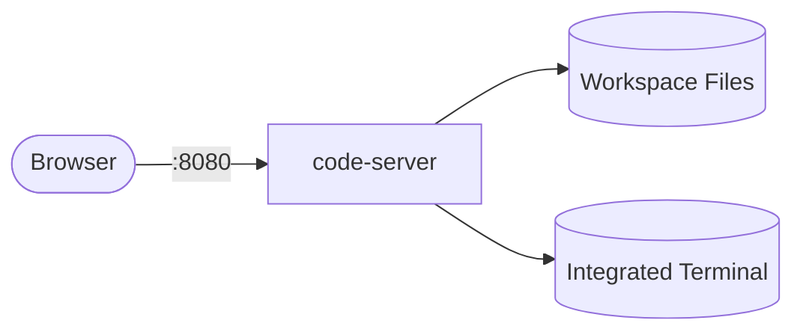

# code-server

code-server playbook to install and configure VS Code in the browser.  
This setup supports Debian/Ubuntu, RedHat family, SUSE, and Arch on amd64/arm64.

## How it works



1. Downloads the official code-server release for the target architecture.
2. Extracts it to `/usr/lib/code-server` and symlinks the binary into `/usr/bin`.
3. Configures `/etc/code-server/config.yaml` with bind address and authentication.
4. Installs a systemd service and enables/starts it.
5. Opens the listening port in the firewall if one is running.

## Playbook details in this repo

- Supported OS: Debian/Ubuntu, RedHat (Fedora, RHEL, CentOS, Rocky, Alma), SUSE, Arch
- Supported architectures: `amd64`, `arm64`
- Default bind address: `127.0.0.1:8080`
- Default auth: `password`
- Install directory: `/usr/lib/code-server`
- Config: `/etc/code-server/config.yaml`
- Service: `code-server`

## Variables

| Variable | Default | Description |
|---|---|---|
| `code_server_version` | `4.96.0` | Release version to install |
| `code_server_install_dir` | `/usr/lib/code-server` | Extraction directory |
| `code_server_bin_dir` | `/usr/bin` | Directory for the binary symlink |
| `code_server_config_dir` | `/etc/code-server` | Configuration directory |
| `code_server_service_user` | `root` | User running the service |
| `code_server_bind_addr` | `127.0.0.1:8080` | Bind address and port |
| `code_server_port` | `8080` | Listening port (used for the firewall) |
| `code_server_auth` | `password` | Auth mode (`password` or `none`) |
| `code_server_password` | `""` | Login password |
| `code_server_cert` | `""` | Optional certificate path |
| `code_server_manage_firewall` | `true` | Open/close the listening port |

## How to run

From the repository root:

```bash
cd code-server
cp inventory.ini.example inventory.ini
ansible-playbook -i inventory.ini setup.yml
```

### Using a vars file

```bash
cp code-server-vars.yml.example code-server-vars.yml
# Edit code-server-vars.yml with your password and bind address
ansible-playbook -i inventory.ini setup.yml -e @code-server-vars.yml
```

### Using inline variables

```bash
ansible-playbook -i inventory.ini setup.yml -e code_server_password=MyPass123
ansible-playbook -i inventory.ini setup.yml -e code_server_bind_addr=0.0.0.0:8080
ansible-playbook -i inventory.ini setup.yml -e code_server_version=4.96.0
```

Remove:

```bash
ansible-playbook -i inventory.ini removal.yml
ansible-playbook -i inventory.ini removal.yml -e code_server_remove_config=false
```

Useful commands:

```bash
ansible-playbook -i inventory.ini setup.yml --check
ansible-playbook -i inventory.ini setup.yml --diff
```

## Operational commands

```bash
# Show version
code-server --version

# Show service status
systemctl status code-server

# View logs
journalctl -u code-server -f

# Open the editor
# http://<host>:8080
```

## Notes

- The playbook downloads the release from GitHub; outbound internet access is required.
- Bind to `127.0.0.1` and access through an SSH tunnel (`ssh -L 8080:127.0.0.1:8080 user@host`) for better security.
- Set `code_server_password` to a strong value; the config task uses `no_log`.
- Use `--check --diff` to preview changes before applying.
- The removal playbook keeps the configuration by default; set `code_server_remove_config=true` to delete it.

## References

- Official site: <https://coder.com/code-server>
- Documentation: <https://coder.com/docs/code-server>
- GitHub releases: <https://github.com/coder/code-server/releases>
- Ansible systemd module: <https://docs.ansible.com/ansible/latest/collections/ansible/builtin/systemd_module.html>
