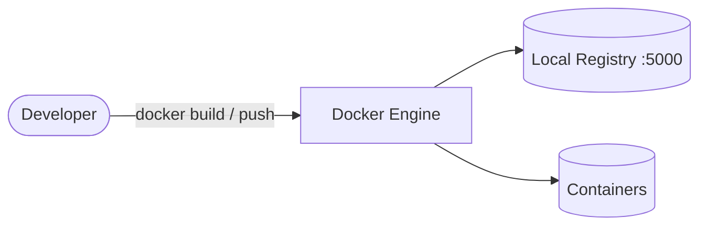

# Docker (with local registry)

Docker playbook to install and configure Docker Engine with an optional local container registry.  
This setup supports Debian/Ubuntu, RedHat family, SUSE, and Arch.

## How it works



1. Installs Docker Engine and the Compose plugin based on the detected OS family.
2. Configures `/etc/docker/daemon.json` with storage, logging, and registry settings.
3. Optionally runs a local `registry:2` container on port `5000`.
4. Enables and starts the Docker service.

## Playbook details in this repo

- Supported OS: Debian/Ubuntu, RedHat (Fedora, RHEL, CentOS, Rocky, Alma), SUSE, Arch
- Default storage driver: `overlay2`
- Default log driver: `json-file`
- Registry port: `5000`
- Registry data: `/var/lib/registry`
- Service: `docker`
- Requirements: `ansible.posix`, `community.general`, `community.docker`

## Variables

| Variable | Default | Description |
|---|---|---|
| `docker_storage_driver` | `overlay2` | Storage driver |
| `docker_log_driver` | `json-file` | Log driver |
| `docker_log_max_size` | `10m` | Max log file size |
| `docker_log_max_file` | `3` | Max number of log files |
| `docker_registry_mirrors` | `[]` | Registry mirror endpoints |
| `docker_insecure_registries` | `[127.0.0.1:5000]` | Insecure (HTTP) registries |
| `docker_users` | `[]` | Users added to the `docker` group |
| `docker_install_compose` | `true` | Install the Compose plugin |
| `docker_registry_enabled` | `true` | Run a local registry |
| `docker_registry_image` | `registry:2` | Registry image |
| `docker_registry_port` | `5000` | Host port for the registry |
| `docker_registry_data_dir` | `/var/lib/registry` | Persistent registry storage |
| `docker_manage_firewall` | `true` | Open/close the registry port |

## How to run

From the repository root:

```bash
cd docker
cp inventory.ini.example inventory.ini
ansible-galaxy collection install community.docker
ansible-playbook -i inventory.ini setup.yml
```

### Using a vars file

```bash
cp docker-vars.yml.example docker-vars.yml
# Edit docker-vars.yml with your daemon and registry settings
ansible-playbook -i inventory.ini setup.yml -e @docker-vars.yml
```

### Using inline variables

```bash
ansible-playbook -i inventory.ini setup.yml -e docker_registry_enabled=false
ansible-playbook -i inventory.ini setup.yml -e 'docker_users=[alice,bob]'
```

Remove:

```bash
ansible-playbook -i inventory.ini removal.yml
ansible-playbook -i inventory.ini removal.yml -e docker_remove_registry_data=true
```

Useful commands:

```bash
ansible-playbook -i inventory.ini setup.yml --check
ansible-playbook -i inventory.ini setup.yml --diff
```

## Operational commands

```bash
# Show Docker version and info
docker version
docker info

# List local images
docker images

# Test the local registry
docker pull hello-world
docker tag hello-world 127.0.0.1:5000/hello-world
docker push 127.0.0.1:5000/hello-world

# Query the registry catalog
curl http://127.0.0.1:5000/v2/_catalog
```

## Notes

- Users added to the `docker` group must log out and back in for the change to apply.
- The local registry is insecure (HTTP); add TLS before using it in production.
- Use `--check --diff` to preview changes before applying.
- The removal playbook keeps registry data by default; set `docker_remove_registry_data=true` to delete it.

## References

- Official site: <https://www.docker.com/>
- Docker documentation: <https://docs.docker.com/>
- Registry image: <https://hub.docker.com/_/registry>
- Ansible docker_container module: <https://docs.ansible.com/ansible/latest/collections/community/docker/docker_container_module.html>
- Ansible systemd module: <https://docs.ansible.com/ansible/latest/collections/ansible/builtin/systemd_module.html>
