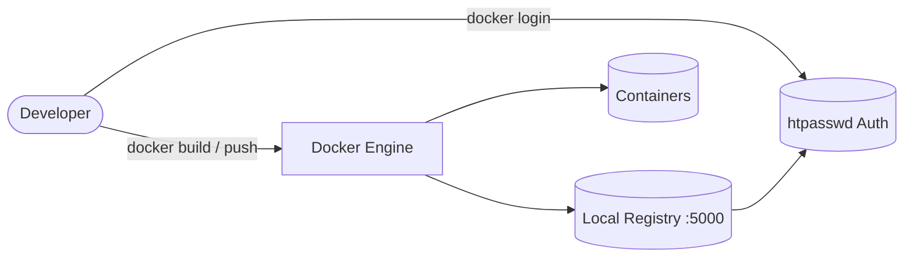

# Docker (with local registry)

Docker playbook to install and configure Docker Engine with an optional local container registry.  
This setup supports Debian/Ubuntu, RedHat family, SUSE, and Arch.

## How it works



1. Installs Docker Engine and the Compose plugin based on the detected OS family.
2. Configures `/etc/docker/daemon.json` with storage, logging, and registry settings.
3. Optionally runs a local `registry:2` container on port `5000`.
4. Enables htpasswd authentication for the registry when `docker_registry_auth` is `true`.
5. Enables and starts the Docker service.

## Registry authentication

Authentication is enabled by default. The playbook creates an htpasswd file with bcrypt
hashed credentials in `/etc/docker-registry/htpasswd` and mounts it into the registry
container read-only. The registry is then started with:

```
REGISTRY_AUTH=htpasswd
REGISTRY_AUTH_HTPASSWD_REALM=Registry Realm
REGISTRY_AUTH_HTPASSWD_PATH=/auth/htpasswd
```

Push and pull then require `docker login`.

## Playbook details in this repo

- Supported OS: Debian/Ubuntu, RedHat (Fedora, RHEL, CentOS, Rocky, Alma), SUSE, Arch
- Default storage driver: `overlay2`
- Default log driver: `json-file`
- Registry port: `5000`
- Registry data: `/var/lib/registry`
- Registry auth: htpasswd (bcrypt) at `/etc/docker-registry/htpasswd`
- Service: `docker`
- Requirements: `ansible.posix`, `community.general`, `community.docker`, and `passlib`

## Variables

| Variable | Default | Description |
|---|---|---|
| `docker_storage_driver` | `overlay2` | Storage driver |
| `docker_log_driver` | `json-file` | Log driver |
| `docker_log_max_size` | `10m` | Max log file size |
| `docker_log_max_file` | `3` | Max number of log files |
| `docker_registry_mirrors` | `[]` | Registry mirror endpoints |
| `docker_insecure_registries` | `[127.0.0.1:5000]` | Insecure (HTTP) registries |
| `docker_users` | `[]` | Users added to the `docker` group |
| `docker_install_compose` | `true` | Install the Compose plugin |
| `docker_registry_enabled` | `true` | Run a local registry |
| `docker_registry_image` | `registry:2` | Registry image |
| `docker_registry_port` | `5000` | Host port for the registry |
| `docker_registry_data_dir` | `/var/lib/registry` | Persistent registry storage |
| `docker_registry_auth` | `true` | Enable htpasswd authentication |
| `docker_registry_auth_realm` | `Registry Realm` | Authentication realm |
| `docker_registry_htpasswd_dir` | `/etc/docker-registry` | Directory holding the htpasswd file |
| `docker_registry_htpasswd_path` | `/etc/docker-registry/htpasswd` | htpasswd file path |
| `docker_registry_users` | `[admin]` | Registry users (username/password) |
| `docker_manage_firewall` | `true` | Open/close the registry port |

The default `admin` password is a placeholder (`ChangeMe123!`). Override
`docker_registry_users` for anything beyond a lab.

### Example registry users

```yaml
docker_registry_users:
  - username: admin
    password: "ChangeMe123!"
  - username: ci
    password: "AnotherPass456!"
```

## How to run

From the repository root:

```bash
cd docker
cp inventory.ini.example inventory.ini
ansible-galaxy collection install community.docker
pip install passlib
ansible-playbook -i inventory.ini setup.yml
```

### Using a vars file

```bash
cp docker-vars.yml.example docker-vars.yml
# Edit docker-vars.yml with your daemon and registry settings
ansible-playbook -i inventory.ini setup.yml -e @docker-vars.yml
```

### Using inline variables

```bash
ansible-playbook -i inventory.ini setup.yml -e docker_registry_enabled=false
ansible-playbook -i inventory.ini setup.yml -e docker_registry_auth=false
ansible-playbook -i inventory.ini setup.yml -e 'docker_users=[alice,bob]'
ansible-playbook -i inventory.ini setup.yml -e 'docker_registry_users=[{"username":"ci","password":"Secret123!"}]'
```

Remove:

```bash
ansible-playbook -i inventory.ini removal.yml
ansible-playbook -i inventory.ini removal.yml -e docker_remove_registry_data=true
```

Useful commands:

```bash
ansible-playbook -i inventory.ini setup.yml --check
ansible-playbook -i inventory.ini setup.yml --diff
```

## Using the registry

### Login first (authentication is enabled by default)

```bash
docker login 127.0.0.1:5000
# Username: admin
# Password: ChangeMe123!
```

### Push an image to the registry

```bash
docker pull nginx:alpine
docker tag nginx:alpine 127.0.0.1:5000/nginx:alpine
docker push 127.0.0.1:5000/nginx:alpine
```

### Pull an image from the registry

```bash
docker pull 127.0.0.1:5000/nginx:alpine
```

### Use Docker context to work with remote host

```bash
docker context use gcp-vps
docker login 127.0.0.1:5000
docker push 127.0.0.1:5000/nginx:alpine
```

### List all images in the registry

```bash
curl -u admin:ChangeMe123! http://127.0.0.1:5000/v2/_catalog
```

### List all tags for a specific image

```bash
curl -u admin:ChangeMe123! http://127.0.0.1:5000/v2/nginx/tags/list
```

### Check registry health

```bash
curl -u admin:ChangeMe123! http://127.0.0.1:5000/v2/
# Expected response: {}
```

### Delete an image tag from the registry

```bash
# Get the digest
curl -u admin:ChangeMe123! -I http://127.0.0.1:5000/v2/nginx/manifests/alpine

# Delete using the digest from the Docker-Content-Digest header
curl -u admin:ChangeMe123! -X DELETE http://127.0.0.1:5000/v2/nginx/manifests/sha256:<digest>
```

## Loading airgapped/offline images

For airgapped or offline environments with no internet access:

### Export an image on a machine WITH internet

```bash
# Pull the image
docker pull nginx:alpine

# Save to a tar file
docker save nginx:alpine -o nginx-alpine.tar
```

### Transfer the tar file to the airgapped machine

```bash
scp nginx-alpine.tar gcp-user@35.252.71.180:/home/gcp-user/
```

### Load the image on the airgapped machine

```bash
# Direct load into local Docker
docker load -i nginx-alpine.tar
```

### Load AND push to the local registry (recommended)

```bash
# Load the image
docker load -i nginx-alpine.tar

# Login to registry
docker login 127.0.0.1:5000

# Tag and push
docker tag nginx:alpine 127.0.0.1:5000/nginx:alpine
docker push 127.0.0.1:5000/nginx:alpine
```

### Bulk export multiple images

```bash
# Export multiple images at once
docker save nginx:alpine redis:alpine postgres:16 -o images-bundle.tar

# On the airgapped machine
docker load -i images-bundle.tar
```

### Load from registry on airgapped machine

```bash
# Once images are pushed to the registry, pull them on any airgapped machine
docker login 127.0.0.1:5000
docker pull 127.0.0.1:5000/nginx:alpine
```

## Testing with curl

### Basic health check (no auth needed)

```bash
curl http://127.0.0.1:5000/v2/
# Expected: {}
```

### Health check with auth

```bash
curl -u admin:ChangeMe123! http://127.0.0.1:5000/v2/
# Expected: {}
```

### List all repositories in registry

```bash
curl -u admin:ChangeMe123! http://127.0.0.1:5000/v2/_catalog
# Expected: {"repositories":["nginx"]}
```

### List tags for an image

```bash
curl -u admin:ChangeMe123! http://127.0.0.1:5000/v2/nginx/tags/list
# Expected: {"name":"nginx","tags":["alpine"]}
```

### Get image manifest

```bash
curl -u admin:ChangeMe123! http://127.0.0.1:5000/v2/nginx/manifests/alpine
```

### Test from remote host (via SSH)

```bash
ssh gcp-user@35.252.71.180 "curl -u admin:ChangeMe123! http://127.0.0.1:5000/v2/_catalog"
```

### Verify authentication is working (should get 401 without credentials)

```bash
curl http://127.0.0.1:5000/v2/_catalog
# Expected: {"errors":[{"code":"UNAUTHORIZED",...}]}
```

## Operational commands

```bash
# Show Docker version and info
docker version
docker info

# List local images
docker images

# Test the local registry (authentication required)
docker login 127.0.0.1:5000
docker pull hello-world
docker tag hello-world 127.0.0.1:5000/hello-world
docker push 127.0.0.1:5000/hello-world

# Logout when done
docker logout 127.0.0.1:5000

# Query the registry catalog (requires credentials)
curl -u admin:ChangeMe123! http://127.0.0.1:5000/v2/_catalog
```

## Notes

- Users added to the `docker` group must log out and back in for the change to apply.
- Registry authentication uses htpasswd with bcrypt hashes; the task runs with `no_log` so passwords are not printed.
- The local registry is insecure (HTTP); add TLS before using it in production.
- `community.general.htpasswd` requires the `passlib` Python library on the control node.
- Use `--check --diff` to preview changes before applying.
- The removal playbook keeps registry data by default; set `docker_remove_registry_data=true` to delete it, and `docker_remove_registry_auth=false` to keep the htpasswd file.

## References

- Official site: <https://www.docker.com/>
- Docker documentation: <https://docs.docker.com/>
- Registry image: <https://hub.docker.com/_/registry>
- Registry authentication: <https://distribution.github.io/distribution/about/authentication/>
- Ansible docker_container module: <https://docs.ansible.com/ansible/latest/collections/community/docker/docker_container_module.html>
- Ansible htpasswd module: <https://docs.ansible.com/ansible/latest/collections/community/general/htpasswd_module.html>
- Ansible systemd module: <https://docs.ansible.com/ansible/latest/collections/ansible/builtin/systemd_module.html>
