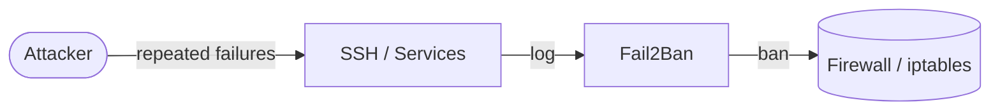

# Fail2Ban

Fail2Ban playbook to install and configure Fail2Ban, an intrusion prevention tool that bans hosts which cause multiple authentication errors.  
This setup supports Debian/Ubuntu, RedHat family, SUSE, and Arch.

## How it works



1. Installs the Fail2Ban package based on the detected OS family.
2. Configures `/etc/fail2ban/jail.local` with global limits and jails.
3. Validates the configuration with `fail2ban-client -t`.
4. Enables and starts the Fail2Ban service.

## Playbook details in this repo

- Supported OS: Debian/Ubuntu, RedHat (Fedora, RHEL, CentOS, Rocky, Alma), SUSE, Arch
- Default bantime: `10m`
- Default findtime: `10m`
- Default maxretry: `5`
- Service: `fail2ban`
- Config: `/etc/fail2ban/jail.local`

## Variables

| Variable | Default | Description |
|---|---|---|
| `fail2ban_ignoreip` | `[127.0.0.1/8, ::1]` | IPs never banned |
| `fail2ban_bantime` | `10m` | Ban duration |
| `fail2ban_findtime` | `10m` | Time window for counting failures |
| `fail2ban_maxretry` | `5` | Failures before a ban |
| `fail2ban_backend` | `auto` | Log backend (`auto`, `systemd`, `polling`) |
| `fail2ban_banaction` | `iptables-multiport` | Action used to ban IPs |
| `fail2ban_destemail` | `root@localhost` | Notification recipient |
| `fail2ban_sender` | `fail2ban@localhost` | Notification sender |
| `fail2ban_mta` | `sendmail` | Mail transport agent |
| `fail2ban_action` | `%(action_mwl)s` | Default action for jails |
| `fail2ban_jails` | `[sshd]` | List of jails to configure |

### Example jail configuration

```yaml
fail2ban_jails:
  - name: sshd
    enabled: true
    port: ssh
    filter: sshd
    maxretry: 5
    bantime: 10m
    findtime: 10m
  - name: nginx-http-auth
    enabled: true
    port: http,https
    filter: nginx-http-auth
    logpath: /var/log/nginx/error.log
    maxretry: 6
```

## How to run

From the repository root:

```bash
cd fail2ban
cp inventory.ini.example inventory.ini
ansible-playbook -i inventory.ini setup.yml
```

### Using a vars file

Copy the example vars file and customize it:

```bash
cp fail2ban-vars.yml.example fail2ban-vars.yml
# Edit fail2ban-vars.yml with your limits, emails, and jails
ansible-playbook -i inventory.ini setup.yml -e @fail2ban-vars.yml
```

### Using inline variables

```bash
ansible-playbook -i inventory.ini setup.yml -e fail2ban_maxretry=3
ansible-playbook -i inventory.ini setup.yml -e fail2ban_bantime=1h
ansible-playbook -i inventory.ini setup.yml -e 'fail2ban_jails=[{"name":"sshd","enabled":true,"port":"ssh"}]'
```

Remove:

```bash
ansible-playbook -i inventory.ini removal.yml
ansible-playbook -i inventory.ini removal.yml -e fail2ban_remove_packages=false
```

Useful commands:

```bash
ansible-playbook -i inventory.ini setup.yml --check
ansible-playbook -i inventory.ini setup.yml --diff
```

## Operational commands

```bash
# Check the Fail2Ban service
systemctl status fail2ban

# List active jails
fail2ban-client status

# Show banned IPs for the sshd jail
fail2ban-client status sshd

# Manually ban an IP
fail2ban-client set sshd banip 203.0.113.10

# Manually unban an IP
fail2ban-client set sshd unbanip 203.0.113.10

# Validate the configuration
fail2ban-client -t
```

## Notes

- The playbook validates the configuration before restarting the service.
- Adjust `fail2ban_ignoreip` to exclude trusted networks or VPNs.
- Use `--check --diff` to preview changes before applying.

## References

- Official site: <https://www.fail2ban.org/>
- GitHub repo: <https://github.com/fail2ban/fail2ban>
- Debian Fail2Ban guide: <https://wiki.debian.org/fail2ban>
- Arch Wiki: <https://wiki.archlinux.org/title/Fail2ban>
- Ansible systemd module: <https://docs.ansible.com/ansible/latest/collections/ansible/builtin/systemd_module.html>
