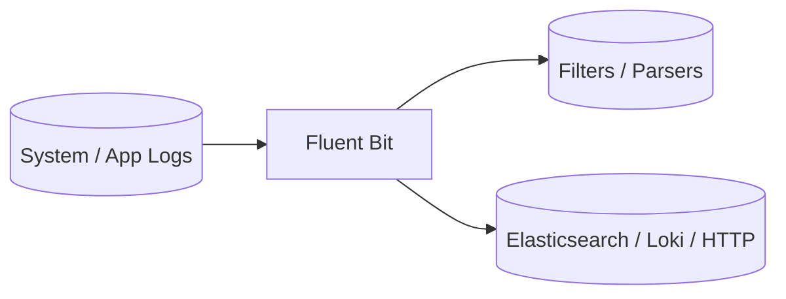

# Fluent Bit

Fluent Bit playbook to install and configure Fluent Bit, a lightweight log processor and forwarder.  
This setup supports Debian/Ubuntu, RedHat family, SUSE, and Arch.

## How it works



1. Installs Fluent Bit based on the detected OS family.
2. Configures `/etc/fluent-bit/fluent-bit.conf` with inputs, filters, and outputs.
3. Validates the configuration with `fluent-bit --dry-run`.
4. Enables and starts the Fluent Bit service.

## Playbook details in this repo

- Supported OS: Debian/Ubuntu, RedHat (Fedora, RHEL, CentOS, Rocky, Alma), SUSE, Arch
- Default flush: `1`
- Default log level: `info`
- Metrics HTTP port: `2020`
- Service: `fluent-bit`
- Config: `/etc/fluent-bit/fluent-bit.conf`

## Variables

| Variable | Default | Description |
|---|---|---|
| `fluentbit_flush` | `1` | Flush interval in seconds |
| `fluentbit_log_level` | `info` | Log level (`error`, `warn`, `info`, `debug`, `trace`) |
| `fluentbit_http_server` | `On` | Enable the built-in HTTP metrics server |
| `fluentbit_http_port` | `2020` | Port for the metrics server |
| `fluentbit_inputs` | `tail /var/log/syslog` | List of input plugins |
| `fluentbit_outputs` | `stdout` | List of output plugins |

### Example input/output configuration

```yaml
fluentbit_inputs:
  - name: tail
    options:
      Path: /var/log/nginx/access.log
      Tag: nginx.access
      Parser: nginx

fluentbit_outputs:
  - name: es
    match: "*"
    options:
      Host: elasticsearch.example.com
      Port: 9200
      Index: fluentbit
      Type: _doc

  - name: loki
    match: "*"
    options:
      Host: loki.example.com
      Port: 3100
      Labels: job=fluentbit
```

## How to run

From the repository root:

```bash
cd fluentbit
cp inventory.ini.example inventory.ini
ansible-playbook -i inventory.ini setup.yml
```

### Using a vars file

```bash
cp fluentbit-vars.yml.example fluentbit-vars.yml
# Edit fluentbit-vars.yml with your inputs and outputs
ansible-playbook -i inventory.ini setup.yml -e @fluentbit-vars.yml
```

### Using inline variables

```bash
ansible-playbook -i inventory.ini setup.yml -e fluentbit_http_port=2021
ansible-playbook -i inventory.ini setup.yml -e fluentbit_log_level=debug
```

Remove:

```bash
ansible-playbook -i inventory.ini removal.yml
ansible-playbook -i inventory.ini removal.yml -e fluentbit_remove_packages=false
```

Useful commands:

```bash
ansible-playbook -i inventory.ini setup.yml --check
ansible-playbook -i inventory.ini setup.yml --diff
```

## Operational commands

```bash
# Test configuration
fluent-bit --dry-run --config=/etc/fluent-bit/fluent-bit.conf

# Show service status
systemctl status fluent-bit

# Query the built-in metrics endpoint
curl http://localhost:2020/api/v1/uptime
```

## Notes

- The playbook validates the configuration before restarting the service.
- Some distributions ship an older Fluent Bit; use the official repo for newer versions.
- Use `--check --diff` to preview changes before applying.

## References

- Official site: <https://fluentbit.io/>
- Fluent Bit documentation: <https://docs.fluentbit.io/>
- GitHub repo: <https://github.com/fluent/fluent-bit>
- Ansible systemd module: <https://docs.ansible.com/ansible/latest/collections/ansible/builtin/systemd_module.html>
