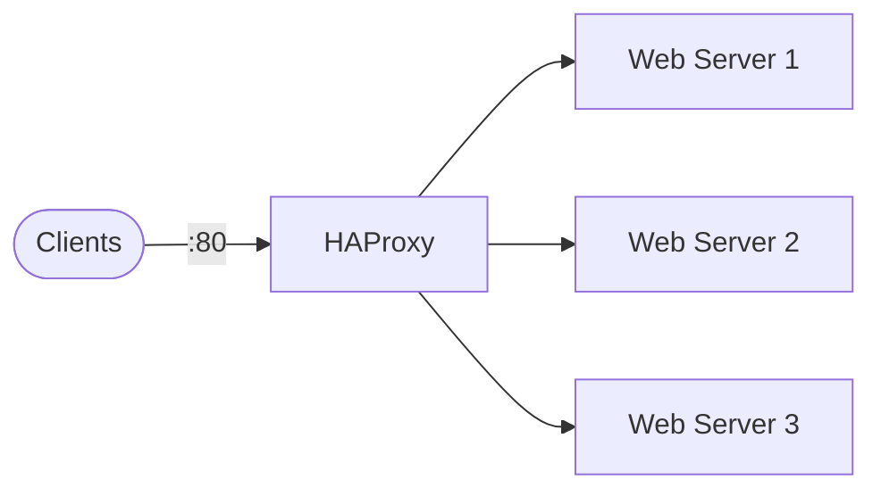

# HAProxy

HAProxy playbook to install and configure HAProxy, a TCP/HTTP load balancer and reverse proxy.  
This setup supports Debian/Ubuntu, RedHat family, SUSE, and Arch.

## How it works



1. Installs HAProxy based on the detected OS family.
2. Configures `/etc/haproxy/haproxy.cfg` with global, defaults, frontends, and backends.
3. Validates the configuration with `haproxy -c`.
4. Enables and starts the HAProxy service.
5. Opens the listening port in the firewall if one is running.

## Playbook details in this repo

- Supported OS: Debian/Ubuntu, RedHat (Fedora, RHEL, CentOS, Rocky, Alma), SUSE, Arch
- Default mode: `http`
- Default maxconn: `4096`
- Service: `haproxy`
- Config: `/etc/haproxy/haproxy.cfg`
- Stats socket: `/run/haproxy/admin.sock`

## Variables

| Variable | Default | Description |
|---|---|---|
| `haproxy_global_maxconn` | `4096` | Global maximum connections |
| `haproxy_defaults_mode` | `http` | Default proxy mode (`http` or `tcp`) |
| `haproxy_defaults_timeout_connect` | `5000` | Connect timeout in ms |
| `haproxy_defaults_timeout_client` | `50000` | Client timeout in ms |
| `haproxy_defaults_timeout_server` | `50000` | Server timeout in ms |
| `haproxy_defaults_retries` | `3` | Retry count |
| `haproxy_frontends` | `[http-in]` | List of frontend listeners |
| `haproxy_backends` | `[webservers]` | List of backend pools |
| `haproxy_manage_firewall` | `true` | Open/close the listening port |

### Example frontend/backend configuration

```yaml
haproxy_frontends:
  - name: http-in
    bind: "*:80"
    default_backend: webservers
    acls:
      - name: api_host
        condition: hdr(host) -i api.example.com
        backend: apiservers

haproxy_backends:
  - name: webservers
    balance: roundrobin
    servers:
      - name: web1
        address: 10.0.0.11
        port: 80
        options: check
      - name: web2
        address: 10.0.0.12
        port: 80
        options: check
  - name: apiservers
    balance: leastconn
    servers:
      - name: api1
        address: 10.0.0.21
        port: 8080
        options: check
```

## How to run

From the repository root:

```bash
cd haproxy
cp inventory.ini.example inventory.ini
ansible-playbook -i inventory.ini setup.yml
```

### Using a vars file

```bash
cp haproxy-vars.yml.example haproxy-vars.yml
# Edit haproxy-vars.yml with your frontends and backends
ansible-playbook -i inventory.ini setup.yml -e @haproxy-vars.yml
```

### Using inline variables

```bash
ansible-playbook -i inventory.ini setup.yml -e haproxy_global_maxconn=8192
```

Remove:

```bash
ansible-playbook -i inventory.ini removal.yml
ansible-playbook -i inventory.ini removal.yml -e haproxy_remove_packages=false
```

Useful commands:

```bash
ansible-playbook -i inventory.ini setup.yml --check
ansible-playbook -i inventory.ini setup.yml --diff
```

## Operational commands

```bash
# Test configuration
haproxy -c -f /etc/haproxy/haproxy.cfg

# Reload without dropping connections
systemctl reload haproxy

# Show server status (requires socat)
echo "show stat" | socat stdio /run/haproxy/admin.sock

# Show errors
echo "show errors" | socat stdio /run/haproxy/admin.sock
```

## Notes

- The playbook validates the configuration before restarting the service.
- Set `haproxy_defaults_mode=tcp` for non-HTTP protocols.
- Use `--check --diff` to preview changes before applying.

## References

- Official site: <https://www.haproxy.org/>
- HAProxy documentation: <https://www.haproxy.org/#docs>
- Debian HAProxy guide: <https://wiki.debian.org/HAProxy>
- Arch Wiki: <https://wiki.archlinux.org/title/HAProxy>
- Ansible systemd module: <https://docs.ansible.com/ansible/latest/collections/ansible/builtin/systemd_module.html>
