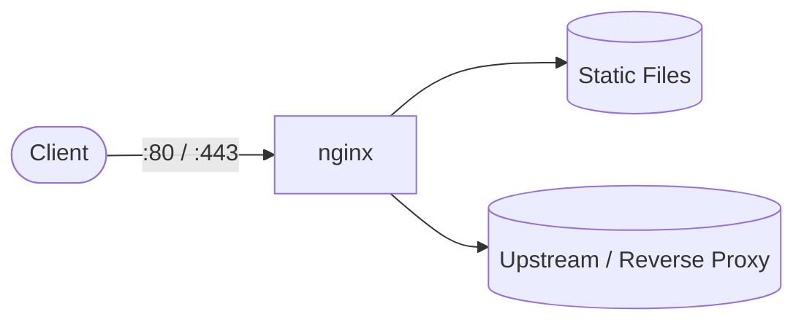

# nginx

nginx playbook to install and configure the nginx web server.  
This setup supports Debian/Ubuntu, RedHat family, SUSE, and Arch.

## How it works



1. Installs nginx based on the detected OS family.
2. Configures `/etc/nginx/nginx.conf` with worker settings and virtual hosts.
3. Validates the configuration with `nginx -t`.
4. Enables and starts the nginx service.
5. Opens HTTP/HTTPS in the firewall if one is running.

## Playbook details in this repo

- Supported OS: Debian/Ubuntu, RedHat (Fedora, RHEL, CentOS, Rocky, Alma), SUSE, Arch
- Default worker processes: `auto`
- Default worker connections: `1024`
- Service: `nginx`
- Config: `/etc/nginx/nginx.conf`
- Firewall: `http`, `https` (firewalld) or `Nginx Full` (ufw)

## Variables

| Variable | Default | Description |
|---|---|---|
| `nginx_worker_processes` | `auto` | Number of worker processes |
| `nginx_worker_connections` | `1024` | Connections per worker |
| `nginx_keepalive_timeout` | `65` | Keepalive timeout in seconds |
| `nginx_gzip` | `on` | Enable gzip compression |
| `nginx_sites` | `[]` | List of virtual hosts (server blocks) |
| `nginx_manage_firewall` | `true` | Open/close HTTP and HTTPS |

### Example site configuration

```yaml
nginx_sites:
  - server_name: example.com
    listen: "80"
    root: /var/www/example.com
    index: index.html index.htm
  - server_name: secure.example.com
    listen: "443"
    root: /var/www/secure
    index: index.html
    ssl_certificate: /etc/nginx/ssl/example.com.crt
    ssl_certificate_key: /etc/nginx/ssl/example.com.key
    extra_directives:
      - "add_header Strict-Transport-Security \"max-age=31536000\" always;"
```

## How to run

From the repository root:

```bash
cd nginx
cp inventory.ini.example inventory.ini
ansible-playbook -i inventory.ini setup.yml
```

### Using a vars file

```bash
cp nginx-vars.yml.example nginx-vars.yml
# Edit nginx-vars.yml with your sites and settings
ansible-playbook -i inventory.ini setup.yml -e @nginx-vars.yml
```

### Using inline variables

```bash
ansible-playbook -i inventory.ini setup.yml -e nginx_worker_processes=2
ansible-playbook -i inventory.ini setup.yml -e 'nginx_sites=[{"server_name":"example.com","root":"/var/www/example.com"}]'
```

Remove:

```bash
ansible-playbook -i inventory.ini removal.yml
ansible-playbook -i inventory.ini removal.yml -e nginx_remove_sites=true
```

Useful commands:

```bash
ansible-playbook -i inventory.ini setup.yml --check
ansible-playbook -i inventory.ini setup.yml --diff
nginx -t
systemctl status nginx
```

## Operational commands

```bash
# Test configuration
nginx -t

# Reload without dropping connections
systemctl reload nginx

# View access/error logs
tail -f /var/log/nginx/access.log
tail -f /var/log/nginx/error.log
```

## Notes

- The playbook validates the configuration before restarting the service.
- SSL certificates must exist before the playbook runs; only paths are referenced.
- Use `--check --diff` to preview changes before applying.
- The removal playbook keeps document roots by default; set `nginx_remove_sites=true` to delete them.

## References

- Official site: <https://nginx.org/>
- nginx documentation: <https://nginx.org/en/docs/>
- Debian nginx guide: <https://wiki.debian.org/Nginx>
- Arch Wiki: <https://wiki.archlinux.org/title/Nginx>
- Ansible systemd module: <https://docs.ansible.com/ansible/latest/collections/ansible/builtin/systemd_module.html>
