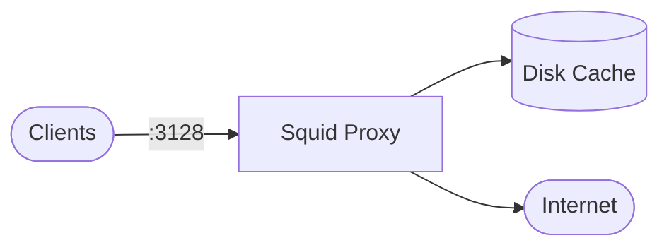

# Squid

Squid playbook to install and configure the Squid caching proxy.  
This setup supports Debian/Ubuntu, RedHat family, SUSE, and Arch.

## How it works



1. Installs Squid based on the detected OS family.
2. Configures `/etc/squid/squid.conf` with the listening port, cache, and ACLs.
3. Initializes the cache with `squid -z` and validates with `squid -k parse`.
4. Enables and starts the Squid service.
5. Opens the proxy port in the firewall if one is running.

## Playbook details in this repo

- Supported OS: Debian/Ubuntu, RedHat (Fedora, RHEL, CentOS, Rocky, Alma), SUSE, Arch
- Default port: `3128`
- Default cache memory: `256 MB`
- Default max object size: `100 MB`
- Service: `squid`
- Config: `/etc/squid/squid.conf`

## Variables

| Variable | Default | Description |
|---|---|---|
| `squid_http_port` | `3128` | Listening port |
| `squid_visible_hostname` | `proxy` | Hostname advertised in errors |
| `squid_cache_mem` | `256 MB` | Memory cache size |
| `squid_maximum_object_size` | `100 MB` | Largest cacheable object |
| `squid_cache_dir` | `/var/spool/squid` | Cache directory |
| `squid_cache_size` | `1000` | Cache size in MB |
| `squid_allowed_networks` | private ranges | Networks allowed to use the proxy |
| `squid_manage_firewall` | `true` | Open/close the proxy port |

### Example network configuration

```yaml
squid_allowed_networks:
  - 192.168.1.0/24
  - 10.10.0.0/16
```

## How to run

From the repository root:

```bash
cd squid
cp inventory.ini.example inventory.ini
ansible-playbook -i inventory.ini setup.yml
```

### Using a vars file

```bash
cp squid-vars.yml.example squid-vars.yml
# Edit squid-vars.yml with your networks and cache settings
ansible-playbook -i inventory.ini setup.yml -e @squid-vars.yml
```

### Using inline variables

```bash
ansible-playbook -i inventory.ini setup.yml -e squid_http_port=8080
ansible-playbook -i inventory.ini setup.yml -e 'squid_allowed_networks=["192.168.1.0/24"]'
```

Remove:

```bash
ansible-playbook -i inventory.ini removal.yml
ansible-playbook -i inventory.ini removal.yml -e squid_remove_cache=true
```

Useful commands:

```bash
ansible-playbook -i inventory.ini setup.yml --check
ansible-playbook -i inventory.ini setup.yml --diff
```

## Operational commands

```bash
# Test configuration
squid -k parse

# Re-read configuration without restart
squid -k reconfigure

# Show service status
systemctl status squid

# Watch access logs
tail -f /var/log/squid/access.log
```

## Notes

- The playbook initializes the cache and validates the configuration before starting.
- Restrict `squid_allowed_networks` to trusted networks in production.
- Use `--check --diff` to preview changes before applying.
- The removal playbook keeps cached data by default; set `squid_remove_cache=true` to delete it.

## References

- Official site: <https://www.squid-cache.org/>
- Squid documentation: <https://wiki.squid-cache.org/>
- Debian Squid guide: <https://wiki.debian.org/Squid>
- Arch Wiki: <https://wiki.archlinux.org/title/Squid>
- Ansible systemd module: <https://docs.ansible.com/ansible/latest/collections/ansible/builtin/systemd_module.html>
