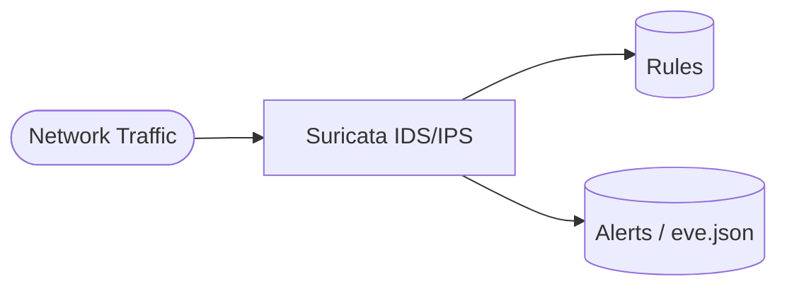

# Suricata

Suricata playbook to install and configure Suricata, a network intrusion detection and prevention system (IDS/IPS).  
This setup supports Debian/Ubuntu, RedHat family, SUSE, and Arch.

## How it works



1. Installs Suricata based on the detected OS family.
2. Configures `/etc/suricata/suricata.yaml` with networks, interfaces, and rules.
3. Validates the configuration with `suricata -T`.
4. Enables and starts the Suricata service.

## Playbook details in this repo

- Supported OS: Debian/Ubuntu, RedHat (Fedora, RHEL, CentOS, Rocky, Alma), SUSE, Arch
- Default HOME_NET: `[192.168.0.0/16,10.0.0.0/8,172.16.0.0/12]`
- Default interface: `eth0`
- Service: `suricata`
- Config: `/etc/suricata/suricata.yaml`
- Output: `/var/log/suricata/eve.json`

## Variables

| Variable | Default | Description |
|---|---|---|
| `suricata_home_net` | private ranges | Networks considered internal |
| `suricata_interfaces` | `[eth0]` | Interfaces to inspect |
| `suricata_default_rule_path` | `/var/lib/suricata/rules` | Directory containing rules |
| `suricata_rule_files` | `[suricata.rules]` | Rule files to load |

### Example interface and network configuration

```yaml
suricata_home_net: "[10.0.0.0/8]"
suricata_interfaces:
  - eth0
  - eth1
suricata_rule_files:
  - suricata.rules
  - custom.rules
```

## How to run

From the repository root:

```bash
cd suricata
cp inventory.ini.example inventory.ini
ansible-playbook -i inventory.ini setup.yml
```

### Using a vars file

```bash
cp suricata-vars.yml.example suricata-vars.yml
# Edit suricata-vars.yml with your networks and interfaces
ansible-playbook -i inventory.ini setup.yml -e @suricata-vars.yml
```

### Using inline variables

```bash
ansible-playbook -i inventory.ini setup.yml -e 'suricata_interfaces=[eth0,eth1]'
ansible-playbook -i inventory.ini setup.yml -e 'suricata_home_net=[10.0.0.0/8]'
```

Remove:

```bash
ansible-playbook -i inventory.ini removal.yml
ansible-playbook -i inventory.ini removal.yml -e suricata_remove_packages=false
```

Useful commands:

```bash
ansible-playbook -i inventory.ini setup.yml --check
ansible-playbook -i inventory.ini setup.yml --diff
```

## Operational commands

```bash
# Test configuration
suricata -T -c /etc/suricata/suricata.yaml

# Show service status
systemctl status suricata

# Watch alerts
tail -f /var/log/suricata/eve.json

# List loaded rules
suricata --dump-config | grep -i rule-files
```

## Notes

- The playbook validates the configuration before restarting the service.
- Ensure the configured interfaces exist on the target host.
- Use `--check --diff` to preview changes before applying.

## References

- Official site: <https://suricata.io/>
- Suricata documentation: <https://docs.suricata.io/>
- GitHub repo: <https://github.com/OISF/suricata>
- Arch Wiki: <https://wiki.archlinux.org/title/Suricata>
- Ansible systemd module: <https://docs.ansible.com/ansible/latest/collections/ansible/builtin/systemd_module.html>
